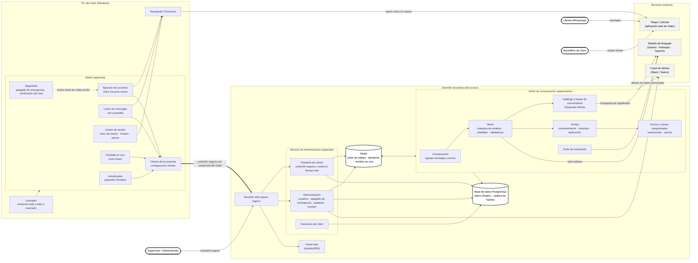

# Diagrama de arquitectura (alto nivel)

Componentes del software del agente RPA y cómo se comunican. El robot del PC habla **solo** con la
pasarela del servidor: nunca recibe base de datos, Redis ni claves.

## Componentes

| Capa | Componente | Responsabilidad |
| --- | --- | --- |
| PC del robot | Robot (`apps/rpa`) y Chromium | Inicia sesión en ySocial, lee mensajes y actúa (escribir, pegar imágenes, transferir, finalizar) solo por el ejecutor de acciones, revisando antes de cada acción el apagado de emergencia y la identidad del chat. |
| PC del robot | Lanzador y actualizador | Arranca el robot, instala versiones firmadas y vuelve a la anterior si la nueva falla. |
| Servidor | Servidor web seguro (nginx) | Conexión cifrada; sirve el panel y dirige las peticiones al servicio de administración. |
| Servidor | Servicio de administración (`apps/api`) | Pasarela de robots, panel de administración, apagado de emergencia, auditoría, monitor en vivo y versiones del robot. |
| Servidor | Motor de conversación (`apps/worker`) | Máquina de estados, plantillas, validadores contra datos inventados, catálogo y bases de conocimiento, ventas, envíos, tareas programadas y suite de evaluación. |
| Servidor | Redis | Colas de trabajo entre procesos (mensajes de entrada, envíos por robot, transferencias, cierres, evaluaciones), banderas de pausa y apagado, y monitor en vivo. |
| Servidor | PostgreSQL | Conversaciones y resúmenes cifrados, catálogo, configuración del agente, consentimientos y registro de acciones con cadena de hashes. |
| Externo | Abaya / ySocial | Aplicación donde el cliente escribe y donde el backoffice recibe la venta. |
| Externo | Modelo de lenguaje | Redacta las respuestas y apoya la búsqueda en el catálogo; no decide el flujo. |
