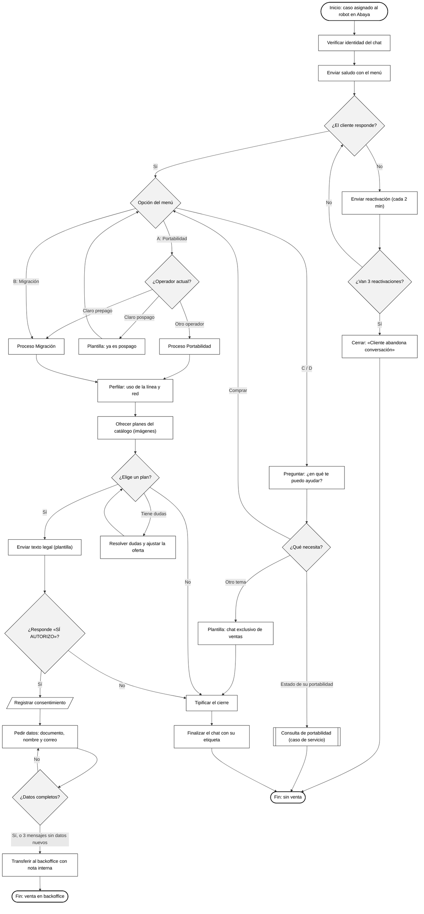

# Diagrama de proceso — Atención de un chat de ventas por el robot

Flujo de negocio de un caso asignado al robot en Abaya (ySocial), desde la asignación hasta la
transferencia al backoffice o el cierre. Símbolos clásicos: óvalo = inicio/fin, rectángulo = actividad,
rombo = decisión, paralelogramo = dato, rectángulo doble = subproceso.

## Reglas que muestra el diagrama

- El robot verifica la identidad del chat antes de escribir.
- El camino lo decide la máquina de estados (el flujo del agente en el panel); el modelo solo redacta.
- Precios y planes salen del catálogo publicado; el texto legal es una plantilla.
- Solo un «SÍ AUTORIZO» explícito cuenta como consentimiento, y queda registrado con cadena de hashes.
- Migración: uso → red. Portabilidad: operador → uso → red. Línea nueva solo si el cliente la pide.
- Los datos que faltan se piden cuando el cliente deja de escribir (45 s); tras 3 mensajes sin datos
  nuevos la venta se transfiere igual.
